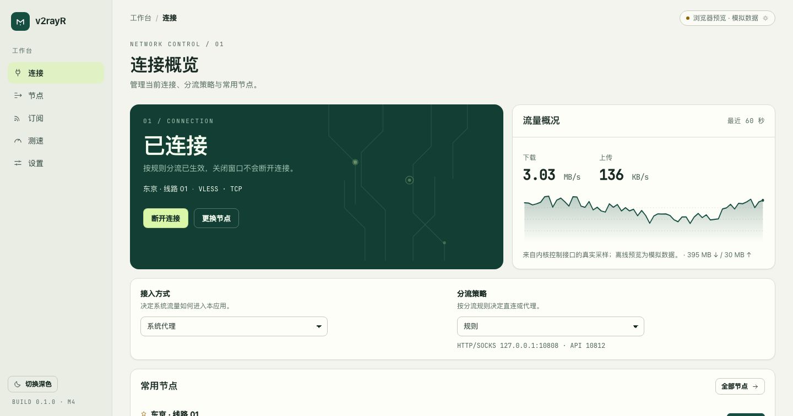
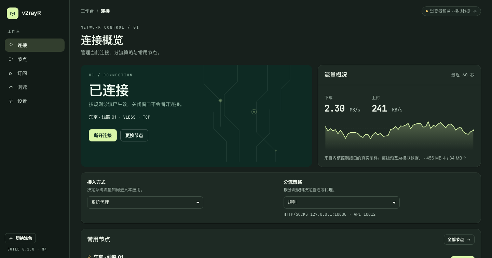
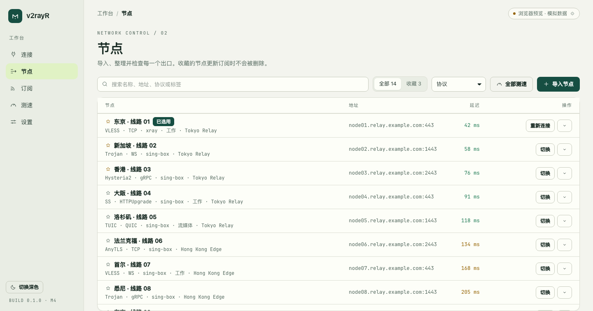
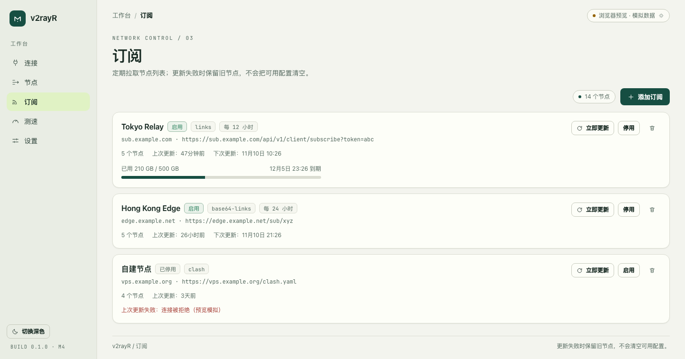
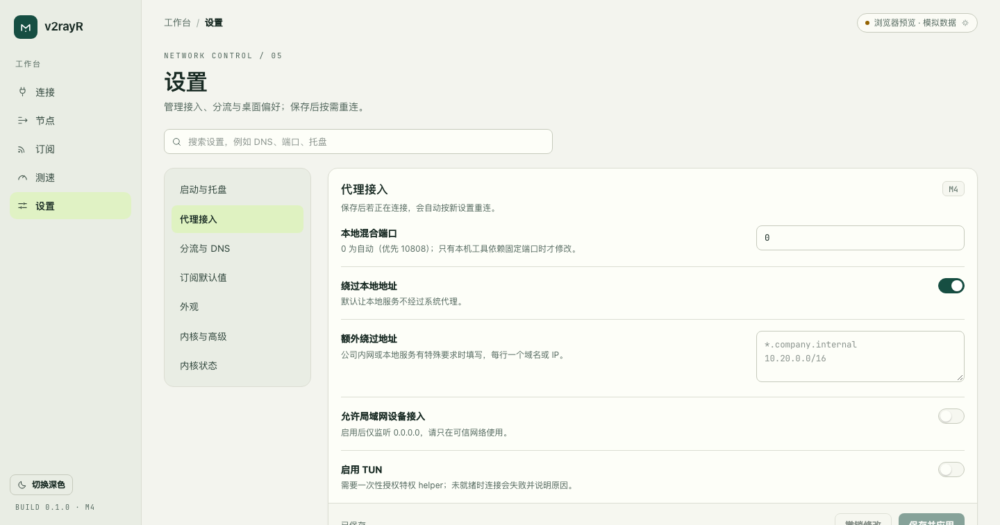

# v2rayR

面向 macOS、Windows 和 Linux 的代理客户端：Rust 负责节点、订阅、内核与系统接管，React 负责工作台界面。
界面语言中文优先，也提供英文；浅色与深色两套主题跟随系统，可手动覆盖。

> 目标不是「又一个订阅转换器」，而是把三件容易出错的事做对：
> **连接状态不说谎**（接管失败就不显示已连接）、**失败不破坏配置**（订阅更新失败保留旧节点、接管失败回滚系统代理）、**设置可见可撤销**（按组草稿、保存前校验、保存后按需重连）。

## 截图

| 连接（浅色） | 连接（深色） |
| --- | --- |
|  |  |

| 节点 | 订阅 | 设置 |
| --- | --- | --- |
|  |  |  |

表中的界面是在浏览器里以 **离线预览模式**（`ui/` 直接用 mock 后端启动）截取的，不读写本机任何配置；
数据目录、系统代理、内核进程都只在桌面壳里才真正生效。

## 能力

- **节点**：导入 vless / vmess / trojan / ss / socks / http / hysteria2 / tuic / wireguard / anytls / naive 分享链接，
  支持整段 base64 与多行文本；按连接指纹去重，保留收藏、标签与延迟记录；10k 节点虚拟滚动。
- **订阅**：链接列表、base64 列表、SIP-008 JSON、Clash YAML、sing-box JSON 五类载荷；按指纹合并
  （新增 / 原地更新 / 删除非收藏），失败只记录错误并保留旧节点；记录配额与到期时间；按间隔自动检查（桌面运行时）。
  原生配置里被跳过的条目会逐条给出原因，一处都无法导入时直接报错而不是清空节点。
- **内核**：sing-box（默认）、Xray（VLESS + xhttp / mKCP 等场景）、mihomo（可选）；可在设置里下载/升级，
  固定版本 + SHA-256 校验，解压后原子替换。配置由强类型构建器生成 → 内核 `check`/`-test`/`-t` 自检
  （失败时把内核原话翻译成一句可行动的提示）→ 原子落盘 → 启动 → 通过本地 HTTP 代理验证链路，再接管。
- **接管**：macOS、GNOME Linux 与 Windows 默认 LAN 的系统代理 / PAC（本机脚本，按域名绕行），以及手动端口；写入前先持久化恢复记录，接管与恢复均读回，恢复失败保留记录。
  TUN 使用管理员部署的独立 helper，详见 [Linux](docs/tun-linux.md) 与 [macOS / Windows](docs/tun-desktop.md)。认证 LAN 使用独立端口和临时凭据。
- **分流**：内置规则集 + 图形化自定义规则（域名 / 后缀 / 网段 / 进程 / GeoIP / GeoSite，直连·代理·拦截），
  改动即时保存、下次连接生效。
- **桌面**：开机启动（LaunchAgent）、关闭窗口保留连接、单实例锁 + 托盘菜单（显示 / 重连 / 断开 / 退出）、
  `v2rayr://import/<base64>` 与命令行分享链接导入。
- **诊断**：内核探测与版本、结构化错误码（`error.*`，前端有中文文案）、日志环形缓冲与 `logs` 命令。
- **CLI**：`v2rayr` 覆盖导入、订阅、连接、测速、导出、诊断，可在无 UI 的机器上排查问题。

## 架构

```
apps/cli            v2rayr       命令行入口（anyhow 边界）
apps/desktop        Tauri 2 壳    窗口、命令注册、事件转发（独立 workspace，需装 tauri-cli 编译）
crates/ipc          线协议        DTO、错误 Problem、事件名、命令名（UI 只认这一层）
crates/app          编排          会话状态机、串行操作锁、设置草稿式保存、订阅刷新、测速、导入
crates/config       发射器        SessionPlan → sing-box / Xray / mihomo 配置 + YAML 写出
crates/domain       领域          协议模型、分享链接解析/导出、指纹、订阅嗅探、合并计划
crates/store        SQLite        节点、订阅、规则、流量样本、会话记忆
crates/engine       内核实务      内核探测与启动、配置自检、Clash API 采样、TCP 延迟、订阅抓取
crates/platform     平台          networksetup 代理、端口探测、LaunchAgent、路径约定
crates/helper       特权         一次性 token 鉴权的 apply/restore/autostart 辅助进程
ui                  React 19     工作台（Vite 6 + TS + Tailwind v4 + zustand）
```

连接一次的数据流：

```
UI ──invoke(session_connect)──► app::App::connect
                                  ├─ choose_core(profile, settings.core_override)
                                  ├─ 端口占用前置检查（被占用直接报 port_in_use + 占用者）
                                  ├─ config::emit(SessionPlan) → 内核 JSON
                                  ├─ 内核 check/-test → 不自检通过就不启动
                                  ├─ engine::KernelProcess::launch + wait_ready(inbound_port)
                                  ├─ platform::SystemProxy::apply → TakeoverSnapshot 落盘
                                  └─ 成功：Connected；任一失败：停内核 + 恢复快照 + Failed
```

更细的约束（状态机、错误模型、端口映射、迁移策略）见 [docs/architecture.md](docs/architecture.md)。

## 快速开始

```bash
# 1. 编译后端与 CLI（无需网络，只要能解析 crates.io）
cargo build --workspace

# 2. 用一个临时数据目录试运行
V2RAYR_HOME=/tmp/v2rayr ./target/debug/v2rayr status
./target/debug/v2rayr import 'vless://...'
./target/debug/v2rayr connect 'Tokyo' --mode manual   # 连上、验证、立刻断开
./target/debug/v2rayr run 'Tokyo' --mode manual       # 保持连接，Ctrl-C 退出
./target/debug/v2rayr install xray                    # 下载固定版本内核（校验 SHA256 + geoip/geosite）
./target/debug/v2rayr test                            # 只测 TCP 延迟，不走代理

# 3. 界面（离线预览：mock 后端，不写本机配置）
cd ui && pnpm install && pnpm dev     # http://localhost:1420

# 4. 桌面壳（需要 tauri-cli 与完整工具链）
cargo install tauri-cli --version "^2"
pnpm --dir ui build                 # 先把 UI 打包并内联成单文件
bash scripts/stage-desktop-cores.sh # 下载、校验并准备当前平台的内置内核
cd apps/desktop && cargo tauri build   # 产出 .app 与 .dmg
```

CLI 常用命令：`status`、`nodes`、`import <file|->`、`sub add/update/list`、`connect/disconnect/run`、`test`、
`export`、`cores`、`logs`、`paths`。`connect` 是自检语义（连上随后断开），需要常驻连接用 `run`；
`test` 不做代理，只测到节点的 TCP 延迟。所有命令接受 `--json`。

桌面安装包内置 Xray 和 sing-box，桌面版优先使用包内的版本，无需首次下载，也不会被用户目录下的同名内核覆盖。Mihomo 仍按需安装。TUN 特权助手使用单独部署的内核。

## 数据目录

默认 `~/Library/Application Support/v2rayR`，可用 `V2RAYR_HOME` 覆盖（测试与便携模式）。

```
config/settings.json      设置（带 schema 版本，读写前校验）
config/secrets/           加密密钥（sqlite 载荷用）
data/v2rayr.db            节点、订阅、规则、流量样本（WAL，0600）
data/cores/               放置 sing-box / xray / mihomo 可执行文件（也可用 PATH）
data/rules/               可选规则集（*.srs），存在才参与配置
run/                      内核配置、接管快照、helper token
logs/                     内核日志与应用日志
```

## 兼容性

| 场景 | 选择 | 说明 |
| --- | --- | --- |
| VLESS + xhttp / mKCP / QUIC | Xray | Xray 无混合入站，SOCKS 与 HTTP 分端口，系统代理写 SOCKS 端口 |
| VLESS Encryption（`mlkem768x25519plus.*`） | Xray ≥ 25.9 | 目前只有 Xray 理解该字段；已实测 Reality + vision + 0-RTT 可连通 |
| Reality / XTLS vision（普通 VLESS） | sing-box 或 Xray | 默认 sing-box，`coreOverride` 可切 Xray |
| Hysteria2 / TUIC / AnyTLS / Naive | sing-box | |
| Shadowsocks 2022 | sing-box | 旧版流式加密同样可用 |
| 其余 | sing-box | 可用 `advanced.coreOverride` 显式指定，但仍校验内核能力 |

## 质量门禁

```bash
cargo fmt --all -- --check
cargo clippy --workspace --all-targets -- -D warnings
cargo test --workspace                     # 常规回归
cd ui && node node_modules/typescript/bin/tsc --noEmit && node node_modules/vite/bin/vite build
```

CI 与本地一致：见 [.github/workflows/ci.yml](.github/workflows/ci.yml) 与 [docs/development.md](docs/development.md)。

## 已知限制

- 桌面壳（`apps/desktop`）不在 workspace 内，需要 `tauri-cli` 与网络代理拉取依赖；CI 里有独立的 build job。
- Clash / sing-box 原生配置只支持常见出站类型；不支持的协议、插件与传输方式会被跳过并给出原因。
- TUN 当前使用全局分流和固定 IPv4 的 sing-box 节点。macOS 与 Windows 接入已有实现，仍需本机提权、真实接管和恢复验收。
- 规则集（`*.srs`）不随仓库分发，放入 `data/rules/` 后才会被引用；否则规则模式只用内置私有网段与自定义规则。
- 开机自启使用 macOS LaunchAgent、Windows 当前用户 Run 键和 Linux XDG 桌面入口。Linux 已验证 GSettings 配置往返；Windows WinINet 和两平台安装包仍需原生验收。
- LAN 认证适用于 sing-box 和 Xray。便携备份与 HTTPS WebDAV 仅保存白名单偏好和规则。
- 签名应用更新与签名候选包见 [发布配置](docs/signed-release.md)；正式证书、公网更新源及实机升级验收尚未配置。
- 本机验证和未通过的发行门槛见 [开发验收记录](docs/delivery-status.md)。

## 许可

GPL-3.0-or-later，见 [LICENSE](LICENSE) 与 [NOTICE](NOTICE)。
内核二进制不随仓库分发，第三方组件的许可见 [resources/licenses/README.md](resources/licenses/README.md)。
