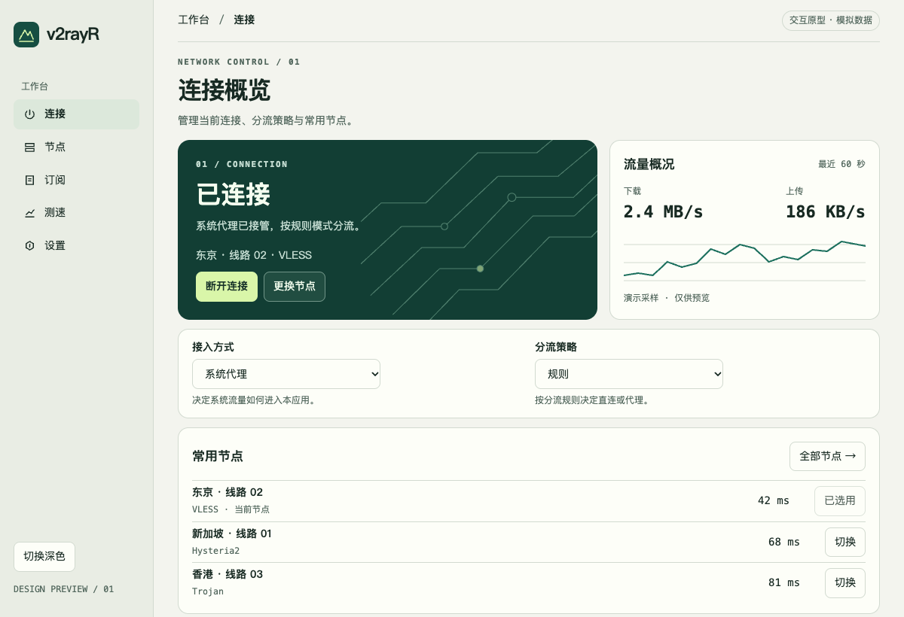
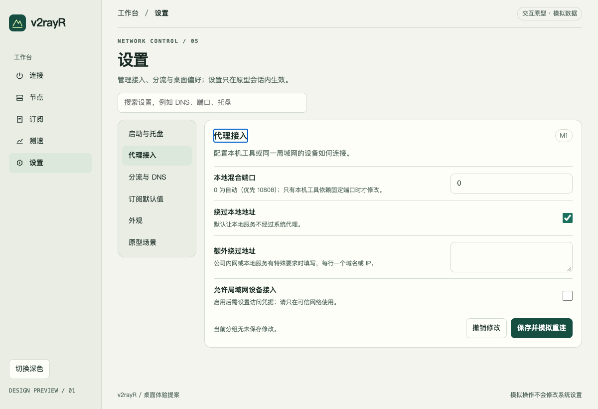

# v2rayR 设计方案

> 用 Rust 复刻 v2rayN：Windows / macOS / Linux 三平台，更美观的界面、更友好的交互、开箱即用。

| 项目 | 内容 |
| --- | --- |
| 文档版本 | v0.3（设计评审稿 · 设置按场景收敛） |
| 日期 | 2026-11-09 |
| 上游参照 | [richenlin/v2rayN](https://github.com/richenlin/v2rayN)（v2rayN 主线，GPL-3.0，约 8.0 万行 C#） |
| 目标产物 | `v2rayR` 桌面应用（GUI）+ `v2rayr-cli`（无头模式，可选）+ `v2rayr-helper`（TUN 特权助手） |
| 一句话技术路线 | **Tauri 2（Rust + React）+ Xray/sing-box sidecar 内核 + 类型化配置生成 + 全平台原生系统代理/TUN** |

---

## 0. 摘要（TL;DR）

v2rayN 的本质不是"代理协议实现"，而是**一个把订阅、节点、内核配置、系统代理、TUN、测速、更新串起来的胶水层**。它的 4 万行核心逻辑（ServiceLib）里，真正不可替代的是：

1. **分享链接 / 订阅的解析与归一化**（12 种 scheme、链接列表/整份配置/Clash YAML 三类载荷）；
2. **把统一节点模型翻译成 Xray / sing-box / mihomo 的 JSON 配置**（这是最易错、最需要测试的部分）；
3. **内核进程生命周期管理**（启动、健康检查、日志、崩溃恢复、端口分配）；
4. **三平台系统代理与 TUN 的落地方案**。

因此 v2rayR 的策略是：

- **不重写代理协议**，继续使用久经考验的开源内核（sing-box 为主、Xray 补充、mihomo 可选），Rust 只做"控制面"；
- **用类型系统替换 v2rayN 的字符串魔法**：`Profile` 用 `enum Protocol` + 强类型 transport/TLS 结构，配置生成器用 `serde` 构造而非字符串拼 JSON；
- **UI 用 Web 技术栈做到"能看、好点、不吓人"**，把设置按任务归类，只在需要时展示对应字段；
- **默认值即最佳实践**：装完 → 粘贴订阅 → 点一下 → 能用。高级项全部收进第二层。

**关键决策一览**

| 决策点 | 结论 | 理由（一句话） |
| --- | --- | --- |
| GUI 框架 | Tauri 2 + React 19 + TS + Tailwind v4 | 视觉/交互上限最高，Tauri 插件生态覆盖托盘/自启/更新/快捷键/深链 |
| 代理内核 | sidecar：sing-box（默认）+ Xray（补充）+ mihomo（可选） | 协议覆盖全、性能经过验证；自研内核不现实 |
| 双内核切换 | 按"节点协议 + 传输层"自动选核，用户可覆盖 | sing-box 无 mKCP/XHTTP，Xray 无 Hysteria2/TUIC，必须互补 |
| 存储 | SQLite（节点/订阅/规则/统计）+ `settings.json`（可读、可手改） | 迁移与备份简单；高级用户可直接编辑 |
| 配置生成 | 强类型 builder → JSON → 内核 `-test` 校验 → 原子落盘 | 把"配置错误"挡在启动之前 |
| 特权操作 | 独立 helper（root/System），最小权限 + 令牌鉴权 | TUN 不应让整个 GUI 以管理员运行 |
| 许可 | 项目 GPL-3.0；内核按需下载或随包附带许可证 | 与上游一致，规避分发争议 |

---

## 1. 上游 v2rayN 项目分析

### 1.1 代码地图

| 子项目 | 行数（C#） | 职责 | 对 v2rayR 的参考价值 |
| --- | --- | --- | --- |
| `ServiceLib` | 39,952 | 全部业务逻辑：模型、SQLite、配置生成、订阅、系统代理、更新、统计 | ★★★★★ 语义参照（协议字段、配置结构、边界条件） |
| `v2rayN`（WPF） | 4,503 | Windows 桌面 UI（ReactiveUI） | ★★ 交互流程参照 |
| `v2rayN.Desktop`（Avalonia） | 5,125 | 跨平台桌面 UI | ★★★ 跨平台差异处理参照 |
| `v2rayN.WebAPI` | 24,543 | 无头 REST/SSE 服务（复用 ServiceLib） | ★★ 证明"控制面可与 UI 解耦"，v2rayR 的 CLI 可借鉴 |
| `AmazTool` / `GlobalHotKeys` | 466 | 提权辅助 / 全局热键 | ★★ 提权重启思路 |

**核心目录结构（ServiceLib）**

```
Services/CoreConfig/        配置生成：V2ray/、Singbox/、Clash/
Handler/Fmt/                分享链接解析：Vmess、VLESS、Trojan、SS、Socks、
                            Hysteria2、Tuic、Wireguard、Anytls、Naive、Clash、Singbox
Handler/SubscriptionHandler 订阅抓取与更新
Handler/SysProxy/           Windows / macOS / Linux 系统代理
Handler/Builder/            CoreConfigContextBuilder：节点 → 配置的总装线
Manager/                    CoreManager 进程管理、CoreInfoManager 版本、
                            StatisticsManager、ClashApiManager
Models/Entities/            ProfileItem、SubItem、RoutingItem、RulesItem、
                            DNSItem、ServerStatItem
```

### 1.2 运行机制（抽象成一个流水线）

```
用户操作 ──► Config(guiNConfig.json) + SQLite(guiNDB.db)
                     │
                     ▼
        CoreConfigContextBuilder.Build(node)
          ├─ 按协议+传输层决定内核（CoreTypeItem 可覆盖）
          ├─ 解析路由规则里引用的其它节点（链式代理/分流出口）
          └─ 生成 CoreConfigContext
                     │
                     ▼
   V2rayConfigTemplateService / SingboxConfigTemplateService
     ├─ outbounds：节点 → Xray outbound / sing-box outbound
     ├─ inbounds：socks/http/mixed + API + TUN
     ├─ routing：RulesItem → routing.rules / route.rules
     └─ dns：SimpleDNSItem → hosts/dns servers/fakeip
                     ▼
             config.json ──► 启动内核子进程 ──► 系统代理 / TUN
                     │                              │
                     └────── 日志、统计 API ◄────────┘
```

关键设计事实（逐条对照源码核对，Rust 实现时按此对齐）：

- **配置不是从零拼装，而是"克隆内置模板 + 就地填充"**：`CoreConfigHandler.cs:10-42` 按内核三分派（Custom+mihomo → `CoreConfigClashService`；`RunCoreType==sing_box` → `CoreConfigSingboxService`；其余 → `CoreConfigV2rayService`），三者共享只读快照 `CoreConfigContext` 作为唯一输入，在 JSON 树上就地改字段。**模板优先不是为了省代码，而是为了字段完整**——内核行为对"字段缺失 / 显式 null / 显式 false"敏感，缺省即语义变化。
- **端口是"基址 + 枚举偏移"**：`GetLocalPort = 10808 + (int)EInboundProtocol`（`AppManager.cs:165-169`）→ socks 10808、pac 10811、api 10812、api2 10813、mixed 10814、speedtest 10829。管理 API：Xray 用 `metrics.listen = StatePort`；sing-box 无条件 `clash_api = StatePort2`，且 `StatePort2 = GetFreePort(api2) + (TUN ? 1 : 0)`——TUN 时端口会漂移，统计与 UI 必须读实际值而非硬编码。
- **DNS 与路由耦合**：FakeIP 必须同时做三件事——(a) 入站 `sniffing.destOverride` 里加 `"fakedns"`；(b) DNS 模块生成 fakedns 池（`poolSize = 网段地址数 - 1`，IPv6 时该字段变数组）；(c) 路由里让 fakeip 目标走代理。任一缺失，fakeip 静默失效（表现为"能连但域名全走直连"）。sing-box 侧同理：`route.final` 与 `dns.final` 由 `UseDirectDns` 启发式决定，TUN 必须额外加 `{ip_cidr:[TUN自身/32|128],action:"reject",method:"drop"}` 防自环。
- **geo 资源双轨**：Xray 直接吃 `geosite:xxx` / `geoip:xxx` 与 `bin/*.dat`；sing-box 先把规则里的 geo 引用"翻译"成 `rule_set`（tag `geosite-{name}` / `geoip-{name}`），本地有 `bin/srss/{tag}.srs` 就用本地，否则 remote + `http_clients.detour = proxy`。同一套用户规则要在两条轨道上语义等价，是最容易出偏差的地方。
- **节点模型是"宽表 + JSON 附加字段"**：`ProfileItem` 40+ 列，`ProtoExtra` / `TransportExtra` 是 JSON 字符串（历史迁移产物），`Ids/Ports/Flow/HeaderType` 等已 `[Obsolete]`，`ConfigVersion = 4` 且带三条迁移链。v2rayR 用类型化枚举替代，但导入时必须兼容这些旧字段。
- **每协议可指定内核**（`Config.CoreTypeItem`），`ProfileItem.CoreType` 可再覆盖；能力校验在 `NodeValidator`（sing-box 禁 kcp/xhttp，Shadowsocks 只允许 raw/ws）。v2rayR 简化为"自动选核 + 单点覆盖"。
- **路由规则可以引用节点**：`rules[].outboundTag` 非 `proxy/direct/block` 时按备注名查节点，现场生成 `{IndexId}-proxy-{Remarks}` 出站（"某站点走某节点"）。保留但默认隐藏。

### 1.3 功能全景（按用户价值分组）

| 分组 | v2rayN 能力 | v2rayR 取舍 |
| --- | --- | --- |
| 节点 | 14 种配置类型（含自定义 JSON、出站、策略组、代理链）、分组、排序、搜索、批量编辑、去重 | **全保留**，但"策略组/代理链"降级为高级功能 |
| 订阅 | 多订阅、自动更新、UA 伪装、正则过滤、订阅转换、分享二维码（**无流量/到期解析**：全仓没有处理 `subscription-userinfo`） | 全保留，并新增配额/到期解析与订阅健康度 |
| 路由 | 规则模式/全局/直连；域名/IP/端口/进程/协议规则；geosite/geoip；规则集订阅；自定义 JSON | 保留三模式 + 规则编辑器；默认内置 3 套规则（白名单/黑名单/全局） |
| DNS | 简单 DNS（FakeIP、并行查询、Happy Eyeballs）、每内核独立 DNS、DoH/DoT、hosts | 保留"简单 DNS"作为默认，独立 DNS 进高级 |
| 内核 | Xray / sing-box / mihomo / v2fly / hysteria / naive / tuic / brook / shadowquic / mieru | 只维护 3 个：sing-box、Xray、mihomo |
| 系统集成 | 系统代理（含 PAC）、TUN、自启动、托盘、全局热键、单实例、深链 | 全保留 |
| 测速 | TCPing、真连接延迟、UDP 测试、下载测速、并发、结果持久化 | 全保留，UI 重做为"一键测速 + 结果表" |
| 运维 | 内核/geo 更新、WebDAV 备份、日志、流量统计 | 保留；备份改为"本地导出 + WebDAV" |
| 外观 | 7 套主题、字号/字体、列宽记忆、多语言（~15 种） | 2 主题（跟随系统）+ 3 语言起步（zh-CN / en-US / zh-TW） |

### 1.4 协议 × 内核矩阵（候选分工，待固定版本验证）

下表用于规划适配器。实现时锁定内核版本及各平台资产，对每组协议、传输、TLS、运行方式记录「实测通过 / 不支持 / 未验证」；仅实测通过的组合参与自动选核。

| 协议 / 传输 | sing-box | Xray | mihomo | v2rayR 默认内核 |
| --- | --- | --- | --- | --- |
| VMess（WS/gRPC/HTTPUpgrade/QUIC） | ✅ | ✅ | ✅ | sing-box |
| VLESS + REALITY / Vision | ✅ | ✅ | ✅ | sing-box |
| VLESS + XHTTP / mKCP | ❌ | ✅ | ⚠️ 部分 | **Xray** |
| Trojan | ✅ | ✅ | ✅ | sing-box |
| Shadowsocks（含 2022） | ✅ | ✅ | ✅ | sing-box |
| Hysteria2 | ✅ | ❌ | ✅ | sing-box |
| TUIC v5 | ✅ | ❌ | ✅ | sing-box |
| WireGuard | ✅ | ✅ | ✅ | sing-box |
| AnyTLS / ShadowTLS / Snell | ✅ | ❌ | ⚠️ | sing-box |
| Naive | ✅ | ❌ | ✅ | sing-box |
| SOCKS / HTTP | ✅ | ✅ | ✅ | sing-box |
| TUN | ✅ 原生 | ✅ 原生 | ✅ 原生 | sing-box |
| 规则集（SRS / geosite.dat） | ✅ SRS | ✅ dat | ✅ provider | 各自格式，按内核下载 |

> 优先验证 sing-box，Xray 补充已验证的组合，mihomo 完整配置列入后续能力。覆盖率和包体积待按固定资产与脱敏样本测量。

### 1.5 继承什么、推翻什么

**继承（保证兼容性）**

- 分享链接格式（vmess/vless/trojan/ss/hysteria2/tuic/...）与订阅解析规则 —— 用户资产不能丢；
- 默认"绕过大陆"分流语义、geosite/geoip 思路；
- 系统代理 + TUN 的双通道模型；
- 备份包可读写上游的节点列表（JSON 导出，便于迁移）。

**推翻（这是"更友好"的空间）**

| v2rayN 的问题 | v2rayR 的做法 |
| --- | --- |
| 首启面对空白列表 + 30 个设置页 | 导入并预览 → 一键连接；测速独立且可选 |
| 顶栏 20+ 个图标按钮，功能不可发现 | 左侧 5 个主入口 + 命令面板（⌘K） |
| 设置项平铺（CoreBasic/Tun/Routing/GUI/UI/SpeedTest/Mux/...） | 只暴露用户能决定的偏好和环境差异；底层参数由适配器管理 |
| 连接状态靠托盘图标颜色判断 | 主界面大号状态卡 + 实时流量/延迟 |
| 错误提示是内核 stderr 原文 | 错误码 → 人话建议（端口占用/证书/系统时间/DNS） |
| 节点表是 WPF DataGrid，列多信息杂 | 默认 4 列（节点/协议/延迟/倍率），可切换详细模式 |

---

### 1.6 体验病灶清单（v2rayR 的设计输入）

下面每条都能在源码里定位，是"更友好"的具体靶子，而不是主观评价：

| # | 病灶 | 源码证据 | v2rayR 对策 |
| --- | --- | --- | --- |
| 1 | 设置无搜索、无分组 | `OptionSettingWindow` 1000×600 五个 Tab 内 25 个 ToggleSwitch / 36 个 ComboBox / 16 个 TextBox；22 个配置节散落在 6 个窗口 | 按场景分组并支持搜索；仅在满足使用条件时展开相关字段 |
| 2 | 改设置常需重启内核 | `needReboot` 只覆盖 5 项（`OptionSettingViewModel.cs:315-319`） | 仅使用已验证的运行时 API；其余显示「应用并重连」 |
| 3 | 系统代理失败被静默吞掉 | `SysProxyHandler.cs:63-67` catch 后仍 `return true` | 失败必须可见：状态胶囊变黄 + 原因 + 一键修复 |
| 4 | 默认布局看不到日志 | 未运行 sing-box 时 TabStrip 整体隐藏（`MainWindow.axaml.cs:451-474`） | 日志位于设置 → 诊断，阻断错误在当前页面持续显示 |
| 5 | 托盘不能切换节点 | `TrayMenuServersLimit` 已实现但未绑定 | 托盘直接列最近 5 个节点 + 模式切换 |
| 6 | 节点表 14 列 + 约 20 项右键菜单 | `ProfilesView.axaml.cs:167-176`；列头排序实际改 DB `Sort` | 默认 4 列；排序只影响视图 |
| 7 | TUN 三平台三种心智模型 | Windows 整应用 UAC 重启（`ProcUtils.cs:49-68`）；Unix 以 `sudo -S` 经 stdin 传明文密码（`CoreAdminManager.cs:32-70`）；无 polkit / osascript | 统一为"helper + 一次授权"，密码不经管道 |
| 8 | 首次启动无引导 | 首启仅建空库，`FirstRun` 零命中 | 渐进式首启（§9.3） |
| 9 | 单实例在 mac/Linux 静默退出、不唤醒已有窗口 | `Program.cs:26-42` | 三平台都聚焦已有窗口 |
| 10 | PAC 仅 Windows | `SysProxyHandler.cs:110-117` | 三平台 PAC |
| 11 | 配置无 schema/版本号 | 只有 `ProfileItem.ConfigVersion` | `settings.schema` + 幂等迁移 |
| 12 | 导入节点窗口 1646 行 / 131 控件 | `AddServerWindow` | 一框粘贴 + 实时预览解析结果 |

## 2. 产品设计

### 2.1 目标与非目标

**目标**

1. 小白：安装 → 粘贴一条订阅/链接 → 点"连接" → 浏览器能上网。全程 ≤ 3 次点击，零配置项。
2. 进阶：可以按工作网络需要调整分流、DNS 和接入方式；内核参数由适配器管理。
3. 三平台体验一致：同样的 UI、同样的系统代理能力、同样的 TUN 能力（权限差异用引导消化）。
4. 性能：万级节点列表 60fps；热切换 p95 < 1.5s（本地固定测试链路）；内存常驻 < 200 MB（不含内核）。

**非目标**

- 不实现自有代理协议内核（VMess/VLESS/REALITY/Hysteria2 等）；
- 不做移动端（iOS/Android）、不做路由器固件、不做服务端；
- 不做"机场售卖/账号体系"；不做 Clash 的完整规则语法（只做常用子集）；
- 不追求与 v2rayN 逐字段兼容旧 `guiNConfig.json`（提供一次性导入工具即可）。

### 2.2 信息架构（三层深度）

```
第 1 层（默认可见）
├── 连接        连接按钮、当前节点、接入方式与分流策略、流量摘要
├── 节点        搜索、延迟、测速、收藏、右键菜单
├── 订阅        卡片式（流量条/到期/节点数）、更新、二维码
├── 测速        选择范围、查看进度、结果与取消
└── 设置        启动与托盘 / 代理接入 / 分流与 DNS / 订阅默认值 / 外观

第 2 层（按场景展开或从对应页面进入）
├── 自定义 DNS  仅选择自定义方案后输入直连/代理 DoH
├── 局域网接入  仅开启时填写访问凭据
├── 单条订阅    单独修改来源与更新周期，按需展开兼容字段
└── 维护与诊断  按需执行检查、备份恢复或开启短时诊断

第 3 层（命令行 / 配置文件 / 深链）
└── v2rayr-cli、settings.json、v2rayr://import?...
```

### 2.3 零配置默认值（开箱即用契约）

| 项目 | 默认值 | 用户是否可见 |
| --- | --- | --- |
| 内核 | sing-box（随包内置） | 状态栏 |
| 代理方式 | 系统代理开启（TUN 关闭） | 主开关 + 状态栏 |
| 分流模式 | 规则（绕过大陆白名单） | 主界面分段控件 |
| 本地端口 | 自动模式优先申请 10808；实际绑定端口单独展示 | 代理接入 |
| DNS | 简单 DNS：自动选择直连/代理 DoH；FakeIP 仅在适配验证后开启 | 分流与 DNS |
| 规则集 | 首次连接时后台下载（失败则用内置精简规则） | 首次连接进度 |
| 测速 | TCPing 延迟 + `generate_204` 真连测试，并发 8，超时 5s | 测速页 |
| 订阅更新 | 每 12 小时，仅前台运行时 | 订阅设置 |
| 自动连接 | 关闭 | 常规 |
| 自动更新 | 仅提示，不自动安装 | 更新 |
| 日志 | 默认 warn；阻断问题持续展示并提供恢复动作 | 高级 |
| 语言/主题 | 跟随系统 | 常规 |

### 2.4 主界面与服务流程图



[打开交互原型](../prototype/index.html) · [深色预览](images/main-window-v02-dark.png) · [对照 v0.1 概念图](images/main-window.png)

原型使用固定示例节点。通过「设置 → 原型场景」检查首启、断开和接管失败；侧栏可切换浅色与深色。

主流程：首启空状态 → 粘贴并预览 → 确认导入并保存候选节点 → 连接 → 检查内核、代理链路、流量接管。测速可稍后执行。再次启动恢复节点与策略，默认仍是未连接。连接事务见 §4.4，状态显示见 §9.3。

---

## 3. 技术选型

### 3.1 GUI 框架

| 方案 | 视觉上限 | 跨平台 | 生态 | 包体 | 结论 |
| --- | --- | --- | --- | --- | --- |
| **Tauri 2 + React** | 高（CSS/动效/组件库） | 三平台（WebView2 / WKWebView / WebKitGTK） | 托盘/更新/自启/快捷键/深链插件齐全 | ~10 MB + 系统 WebView | ✅ 采用 |
| Slint | 中（原生控件，样式受限） | 三平台 | 一般 | 小 | 备选（若 Linux WebView 体验翻车） |
| egui | 低（工具感强） | 三平台 | 较好 | 小 | ❌ 达不到"更美观" |
| Dioxus | 中 | 三平台 | 发展中 | 小 | ❌ 桌面成熟度不如 Tauri |
| GPUI | 中高 | macOS 优先 | 早期 | 小 | ❌ Windows/Linux 不稳 |
| Flutter + Rust FFI | 高 | 三平台 | 好 | 大（~40 MB） | ❌ 双栈复杂，Rust 优势被削弱 |

**Tauri 2 的具体收益**：`tauri-plugin-single-instance`（单实例）、`tauri-plugin-autostart`、`tauri-plugin-global-shortcut`、`tauri-plugin-updater`（minisign 签名）、`tauri-plugin-deep-link`（`v2rayr://`）、内置 tray icon、capabilities 权限模型。

**风险与对策**：Linux WebKitGTK 版本差异 → CI 在 Ubuntu 22.04 基线验证；旧版发行版体验降级 → 检测 WebKitGTK < 2.40 时提示；不用 `<dialog>`/`backdrop-filter` 等新特性做核心布局。

### 3.2 内核策略

| 方案 | 协议覆盖 | 工作量 | 性能 | 结论 |
| --- | --- | --- | --- | --- |
| Rust 自研内核 | 需重写 VMess/VLESS/REALITY/XHTTP/Hysteria2/TUIC/WireGuard/TUN… | 人年级 | 未知 | ❌ |
| 仅 sing-box | 缺 XHTTP/mKCP | 低 | 好 | ⚠️ 不足 |
| **sing-box + Xray（+ mihomo 可选）** | 全覆盖 | 中 | 好 | ✅ 采用 |
| 仅 Xray | 缺 Hysteria2/TUIC/AnyTLS | 低 | 好 | ❌ |

**选核规则**（`fn select_core(profile) -> CoreKind`）：

```
protocol == VLESS && transport ∈ {xhttp, mkcp}      -> Xray
protocol ∈ {Hysteria2, TUIC, AnyTLS, Naive, Snell}  -> sing-box
protocol == Shadowsocks && method 为 2022 系        -> sing-box
其他                                                 -> sing-box
用户显式指定 core                                    -> 以用户为准（校验能力后告警）
```

### 3.3 Rust 依赖清单

```toml
tauri = "2"                       # 桌面壳
tauri-plugin-{single-instance,autostart,global-shortcut,updater, \
              deep-link,notification,opener} = "2"
serde / serde_json = "1"          # 模型与配置
tokio = { version = "1", features = ["full"] }
axum = "0.8"                      # 本地 API（CLI/Web 模式复用，可选）
reqwest = { version = "0.13", features = ["rustls-tls", "gzip", "brotli"] }
rusqlite = { version = "0.41", features = ["bundled"] }
anyhow / thiserror                # 错误
tracing / tracing-subscriber      # 结构化日志
uuid / url / base64 / percent-encoding
serde_yaml (clash 导入) · quick-xml（可略）
semver                            # 内核版本比较
sha2 · ed25519-dalek              # 校验与更新签名
keyring                           # WebDAV 凭据走系统钥匙串
sysinfo                           # 进程/端口探测（或 netstat2）
windows / objc2 / nix             # 平台 API（按 target 条件编译）
```

### 3.4 许可与合规

| 组件 | 许可 | 处理方式 |
| --- | --- | --- |
| 本项目 | GPL-3.0（与 v2rayN 一致） | 采纳，避免"衍生作品"争议 |
| sing-box | GPL-3.0 + 名称条款 | 独立进程调用；随包分发需附源码获取方式；不可暗示官方关联 |
| Xray-core | MPL-2.0 | 随包分发，保留许可证文件 |
| mihomo | GPL-3.0 | **默认不随包**，用户在应用内"下载额外内核" |
| 上游代码 | GPL-3.0 | 本项目为独立实现，不复制源码；仅参考行为与数据格式（数据格式不受版权保护） |

> 注意：sing-box 的附加条款禁止"未经许可的衍生作品使用其名称或暗示关联"。因此应用名、UI 文案中只出现"内核版本"，不出现"官方""合作"等表述。

---

## 4. 总体架构

### 4.1 进程与模块拓扑

```
[React WebView]  连接 / 节点 / 订阅 / 测速 / 设置 / 按场景展开
        │  Tauri IPC（command & event，类型化 DTO）
        ▼
[v2rayR app · Rust · 用户权限]
   ├─ domain    模型、分享链接解析、订阅归一化
   ├─ store     SQLite、settings.json、迁移、备份
   ├─ config    XrayEmitter / SingboxEmitter（配置生成与校验）
   ├─ engine    选核、spawn、健康检查、日志、统计、内核更新
   └─ platform  系统代理、自启、托盘、单实例、深链、通知
        │ spawn（stdout/stderr 管道）        │ IPC（unix socket / named pipe）
        ▼                                      ▼
[core: sing-box / xray]  ◄── 启停与日志 ──  [v2rayr-helper · root / LocalSystem]
                                            仅做：建 TUN、配路由/DNS、清理残留
```

**为什么不用"一个 daemon 管所有"**：GUI 与内核同用户运行最简单，避免权限放大；只有 TUN 需要提权，隔离成小 helper 更安全。后续若做 `v2rayr-cli serve`，复用同一套 `engine + domain`，不改变架构。

### 4.2 Cargo workspace 目录

```
v2rayR/
├── Cargo.toml                  # workspace
├── apps/
│   ├── desktop/                # Tauri 壳：窗口、tray、IPC 注册（main.rs 很薄）
│   └── cli/                    # v2rayr-cli：headless / import / test（复用 crates）
├── crates/
│   ├── domain/                 # Profile 模型、share-link 解析、订阅模型、错误
│   ├── store/                  # SQLite、settings.json、迁移、备份
│   ├── config/                 # 配置生成：XrayEmitter / SingboxEmitter / 规则与 DNS
│   ├── engine/                 # 内核发现、启动、健康检查、日志、统计、更新
│   ├── platform/               # 系统代理、自启、托盘辅助、单实例、权限探测
│   └── ipc/                    # tauri command/event DTO（被 desktop / cli 共用）
├── crates/helper/              # 特权助手（独立二进制，最小依赖）
├── ui/                         # React + TS + Vite + Tailwind
│   ├── src/{pages,components,stores,lib,i18n}
│   └── src-tauri 不在此处（apps/desktop 引用 ui/dist）
├── resources/                  # 内置规则、默认图标、PAC 模板、许可文件
├── docs/                       # 本文档、ADR、协议字段表
└── .github/workflows/          # 三平台构建/签名/发布
```

### 4.3 模块职责边界

| crate | 负责 | 不负责 |
| --- | --- | --- |
| `domain` | 节点/订阅/规则的纯数据与解析；无 IO | 不碰数据库、不启进程 |
| `store` | 持久化、事务、迁移、备份导入导出 | 不生成核心配置 |
| `config` | 节点+设置 → 内核 JSON；规则/DNS 编译；配置校验 | 不启动进程 |
| `engine` | 选核、写配置、spawn、日志、健康检查、崩溃重启、版本管理、统计采样 | 不碰 UI、不碰系统代理 |
| `platform` | 系统代理、自启、单实例、通知、托盘菜单构建 | 不解析订阅 |
| `ipc` | 命令入参/事件出参 DTO 与错误码 | 不含业务逻辑 |

### 4.4 关键时序

**连接（首次、切换节点、调整接入）**

由 Rust 会话协调器串行处理 GUI、托盘和 CLI 的请求。请求携带 operation_id，状态快照携带 revision；前端忽略旧修订，事件中断后重读快照。

1. 从已保存节点和设置生成不可变候选，选择已验证的内核组合并执行配置校验；校验失败不动当前会话。
2. 启动内核并确认监听来自本次子进程；端口就绪只说明有监听。再通过本地入口验证所选节点路径；直连模式验证直连路径。探测失败显示「连通性未验证」，允许重试或查看诊断。
3. 系统代理/TUN 写入前记录恢复日志，写入后读回；TUN 验证路由和 DNS。所选接入方式与探测均满足条件才显示「已连接」。只有本地代理可用时显示「仅本地可用」。
4. 接管部分失败先撤销本次写入。保留本地代理时提供「重试接管 / 停止本地代理」。切换失败恢复并验证旧会话；恢复失败显示实际状态和恢复入口。
5. 热切换限于适配器实测支持的操作，例如 [sing-box selector](https://sing-box.sagernet.org/configuration/outbound/selector/) 通过 Clash API 切换已预载出站；route.final 配置变更默认生成配置后重连。断开先恢复接管设置，再停内核；只还原仍由本会话持有的值。强杀后靠下次启动检查或独立守护恢复，不能依赖 Drop。

**订阅更新**

```
UI update_subs(ids)
 → 并发抓取（每订阅独立超时/代理）
 → 嗅探格式 → 解析 → 归一化 → 去重（按 fingerprint）
 → 事务写入：新增/更新/标记失效（保留用户备注、收藏；仅复用仍适用的测速结果）
 → 解析 subscription-userinfo → 更新流量/到期
 → emit sub://progress, sub://done（含新增/失效计数）
```

---

## 5. 数据模型

### 5.1 节点模型（类型化，替代 v2rayN 宽表）

```rust
#[derive(Serialize, Deserialize, Clone)]
pub struct Profile {
    pub id: Uuid,
    pub sub_id: Option<Uuid>,
    pub remark: String,
    pub protocol: Protocol,          // 枚举，携带协议专属字段
    pub address: String,
    pub port: u16,
    pub transport: Transport,        // 枚举
    pub tls: Option<TlsOptions>,
    pub mux: Option<MuxOptions>,
    pub tags: Vec<String>,
    pub extra: serde_json::Value,    // 未知字段透传（导入再导出不丢信息）
}

pub enum Protocol {
    Vmess { id: Uuid, alter_id: u16, security: VmessSecurity },
    Vless { id: Uuid, flow: Option<VlessFlow> },
    Trojan { password: String },
    Shadowsocks { method: SsMethod, password: String },
    Socks { username: Option<String>, password: Option<String> },
    Http { username: Option<String>, password: Option<String> },
    Hysteria2 {
        password: String,
        obfs: Option<Obfs>,
        up_mbps: Option<u32>,
        down_mbps: Option<u32>,
        ports: Option<String>,          // "443,8443" 形式的多端口
    },
    Tuic { uuid: Uuid, password: String, congestion: Option<Congestion> },
    WireGuard {
        private_key: String,
        public_key: String,
        preshared_key: Option<String>,
        mtu: u16,
    },
    AnyTls { password: String },
    Naive { username: String, password: String },
    Chain(Vec<Profile>),             // 代理链（高级）
    Custom { core: CoreKind, json: serde_json::Value },
}

pub enum Transport {
    Raw,                             // tcp
    Ws { path: String, host: Option<String>, early_data: Option<u32> },
    Grpc { service_name: String, multi_mode: bool },
    HttpUpgrade { path: String, host: Option<String> },
    Http { path: String, host: Vec<String> },   // h2 / obfs
    Xhttp { path: String, host: Option<String>, mode: String, extra: serde_json::Value },
    Mkcp { header: MkcpHeader, seed: Option<String> },
    Quic { security: QuicSecurity, key: String, header: String },
}

pub struct TlsOptions {
    pub sni: String,
    pub insecure: bool,
    pub alpn: Vec<String>,
    pub fingerprint: Option<String>,  // chrome/randomized/...
    pub reality: Option<RealityOptions>,   // public_key, short_id, spider_x
    pub ech: Option<String>,
}
```

> 设计要点：**协议差异用枚举承载，共性的 address/port/transport/tls 提到顶层**。这样配置生成器可以写成"匹配枚举 → 生成 outbound"，避免 v2rayN 那种 `if (GetProtocolExtra().Xxx)` 满天飞。

### 5.2 SQLite schema

```sql
PRAGMA journal_mode = WAL;

CREATE TABLE profile (
  id          TEXT PRIMARY KEY,
  sub_id      TEXT REFERENCES subscription(id) ON DELETE SET NULL,
  remark      TEXT NOT NULL,
  protocol    TEXT NOT NULL,          -- 枚举 tag：vless/vmess/trojan/...
  address     TEXT NOT NULL,
  port        INTEGER NOT NULL,
  payload     TEXT NOT NULL,          -- 持久化 DTO：协议参数与秘密引用，不含明文凭据
  sort        INTEGER NOT NULL DEFAULT 0,
  favorite    INTEGER NOT NULL DEFAULT 0,
  created_at  INTEGER NOT NULL,
  updated_at  INTEGER NOT NULL
);
CREATE INDEX idx_profile_sub ON profile(sub_id, sort);

-- 每个连接都启用 PRAGMA foreign_keys = ON；以下为设计草图。
CREATE TABLE profile_ex (            -- 测速结果与统计缓存（可重建）
  profile_id  TEXT PRIMARY KEY REFERENCES profile(id) ON DELETE CASCADE,
  delay_ms    INTEGER,
  speed_bps   INTEGER,
  tested_at   INTEGER,
  ip_info     TEXT
);

CREATE TABLE subscription (
  id TEXT PRIMARY KEY, source_ref TEXT NOT NULL, name TEXT NOT NULL,
  enabled INTEGER DEFAULT 1, update_interval_h INTEGER DEFAULT 12,
  last_update INTEGER, last_error TEXT, user_info TEXT,  -- upload/download/total/expire
  filter_include TEXT, filter_exclude TEXT, sort INTEGER
);

CREATE TABLE routing_profile (
  id TEXT PRIMARY KEY, name TEXT NOT NULL, rules TEXT NOT NULL,
  is_default INTEGER DEFAULT 0, sort INTEGER
);
CREATE TABLE dns_profile (...);
CREATE TABLE stat (                  -- 按天聚合，供"今日用量"与图表
  profile_id TEXT, day TEXT, up INTEGER, down INTEGER, PRIMARY KEY(profile_id, day)
);
CREATE TABLE kv (k TEXT PRIMARY KEY, v TEXT);   -- 迁移版本、模板、窗口状态
```

### 5.3 `settings.json`（精简且可手改）

```jsonc
{
  "schema": 1,
  "language": "zh-CN",
  "theme": "system",
  "start": {
    "launch_at_login": false, "auto_connect": false,
    "start_minimized": false, "hide_dock": false
  },
  "proxy": {
    "system_proxy": true, "tun": false, "mode": "rule",
    "mixed_port": 0, "bypass_local_addresses": true, "exceptions": [], "allow_lan": false
  },
  "core":    { "preferred": "auto", "auto_update": false,
               "log_level": "warn", "mux": false },
  "routing": { "profile_id": "builtin-whitelist" },
  "dns": {
    "mode": "auto",
    "remote_doh": "https://dns.cloudflare.com/dns-query",
    "local_doh": "https://dns.alidns.com/dns-query"
  },
  "subs":    { "update_interval_h": 12, "user_agent": "v2rayR/{version}" },
  "tests":   {
    "latency_url": "https://www.gstatic.com/generate_204",
    "speed_url": "https://speed.cloudflare.com/__down?bytes=10000000",
    "timeout_ms": 5000,
    "concurrency": 8
  },
  "advanced":{ "config_override": null, "core_path": null, "purge_on_exit": false }
}
```

### 5.4 迁移与备份

- 迁移：单文件幂等迁移函数，`kv.schema` 记录版本；启动时 `if schema < N { step_up() }`，失败自动备份旧库并回滚。
- 备份：ZIP 默认导出非秘密设置、规则和数据库脱敏快照（用 SQLite Backup API 或等价的一致性快照）；跨设备恢复需重新提供秘密。WebDAV 用 ETag/If-Match 防覆盖，冲突保留双份。
- 导入 v2rayN：读取其 `guiNConfig.json` + `guiNDB.db`，映射 `ProfileItem` → `Profile`（一次性工具，放在"设置 → 导入"）。

---

## 6. 配置生成引擎

### 6.1 流水线

```
build(node, settings) -> Result<Value>
 1. resolve core：select_core(node, settings.core.preferred)
 2. validate    ：地址/端口/UUID/密码/REALITY pubkey/传输参数（对应 v2rayN NodeValidator）
 3. emit        ：outbounds + inbounds + routing + dns + (tun) + log + api
 4. post        ：用户"完整配置覆盖"（override 仅替换指定 key，不整体替换）
 5. verify      ：写入临时文件 → `core check -c file`（sing-box）/ `xray -test -c file`
 6. commit      ：原子 rename 到 config.json；失败则保留 prev_config.json
```

**关键原则**

- **能力探测而非假设**：生成前读取内核版本（`sing-box version` / `xray version`），不支持的特性（如旧版无 `anytls`）显式报错，不写"看起来对但内核不认"的配置。
- **配置可回滚**：每次成功启动保留上一版 `config.prev.json`，崩溃自动回退。
- **不信任订阅**：节点参数严格校验，注入了非法字段（如 `outbounds` 里的 `exec`）一律丢弃。
- **空值语义显式化**：上游踩过的坑——`uot`/`ota`/`serve_stale` 等字段"写 `false`"与"不写"不等价。Rust 侧统一用 `Option<T>` + `#[serde(skip_serializing_if = "Option::is_none")]`，并对确实需要 `false` 的字段单独建模。
- **tag 唯一性断言**：生成后校验所有 outbound/rule_set/dns server 的 `tag` 唯一，出现 `balancer`/`detour`/`dialerProxy` 引用时确认目标存在——内核只在运行时才报这类错误，且信息晦涩。

**内核能力边界（上游 `CoreConfigHandler` 的硬约束，v2rayR 必须复刻）**

| 组合 | 处理 |
| --- | --- |
| sing-box + `kcp` / `xhttp` 传输 | 不支持：选核阶段就该改派 Xray（上游在 `NodeValidator` 直接判无效） |
| Xray + `quic` 传输 | 不支持：改派 sing-box |
| Shadowsocks + 非 `raw/ws` 传输 | 不支持（`plugin` 语义差异，只能进 `plugin_opts`） |
| mihomo | 不生成 `proxies/groups/rules`，只改写用户的完整 YAML（`mixed-port`、`log-level`、`external-controller`、生成随机管理密钥并强制回环监听、`allow-lan`、`ipv6`、`mode`）；TUN 时用内嵌 `tun` 块覆盖 |
| Xray 路由出站名 | `direct` / `block` / `dns-module` 保留字；其余按节点备注现场生成出站 |

### 6.2 协议映射表（节选）

| 统一字段 | Xray outbound | sing-box outbound |
| --- | --- | --- |
| protocol | `protocol: "vless"` | `type: "vless"` |
| address/port | `settings.vnext[0].address/port` | `server`, `server_port` |
| uuid | `settings.vnext[0].users[0].id` | `uuid` |
| flow | `users[0].flow` | `flow` |
| tls | `streamSettings.security = "tls"` + `tlsSettings` | `tls: { enabled, server_name, insecure, alpn, utls }` |
| reality | `streamSettings.security="reality"` + `realitySettings{publicKey,shortId,serverName,fingerprint}` | `tls.reality: { enabled, public_key, short_id }` |
| ws | `streamSettings.wsSettings{path,headers.Host}` | `transport: { type:"ws", path, headers }` |
| grpc | `grpcSettings{serviceName,multiMode}` | `transport: { type:"grpc", service_name }` |
| xhttp | `xhttpSettings{path,host,mode,extra}` | ❌ → 选 Xray |
| ss | `protocol:"shadowsocks", settings.servers[]` | `type:"shadowsocks", method, password` |
| hysteria2 | ❌ | `type:"hysteria2", password, obfs, up_mbps` |
| tuic | ❌ | `type:"tuic", uuid, password, congestion_control` |
| wireguard | `protocol:"wireguard"` | `type:"wireguard", peers[]` |
| mux | `mux: {enabled, concurrency}` | `multiplex: { enabled, protocol:"h2mux" }` |

### 6.3 示例：VLESS + REALITY（两内核输出）

输入：

```
vless://3f2a...@203.0.113.7:443?encryption=none&flow=xtls-rprx-vision
  &security=reality&sni=www.microsoft.com&fp=chrome
  &pbk=<pubkey>&sid=6ba85179e30d4fc2&type=tcp#日本·东京
```

Xray：

```json
{ "tag": "proxy", "protocol": "vless",
  "settings": { "vnext": [{ "address": "203.0.113.7", "port": 443,
    "users": [{ "id": "3f2a...", "encryption": "none", "flow": "xtls-rprx-vision" }] }] },
  "streamSettings": { "network": "tcp", "security": "reality",
    "realitySettings": { "serverName": "www.microsoft.com", "fingerprint": "chrome",
      "publicKey": "<pubkey>", "shortId": "6ba85179e30d4fc2" } } }
```

sing-box：

```json
{ "type": "vless", "tag": "proxy", "server": "203.0.113.7", "server_port": 443,
  "uuid": "3f2a...", "flow": "xtls-rprx-vision",
  "tls": { "enabled": true, "server_name": "www.microsoft.com",
    "utls": { "enabled": true, "fingerprint": "chrome" },
    "reality": { "enabled": true, "public_key": "<pubkey>", "short_id": "6ba85179e30d4fc2" } } }
```

### 6.4 路由与 DNS 预设

内置 3 套（与 v2rayN 语义对齐，规则数据可内置精简版）：

| 预设 | 行为 | 典型规则 |
| --- | --- | --- |
| 绕过大陆（默认） | 国内直连，国外走代理 | `geosite:cn`→direct；`geoip:cn`→direct；`geosite:geolocation-!cn`→proxy；私有地址→direct；`udp:443`→block |
| 黑名单 | 默认代理，命中列表直连 | `geosite:cn`（可选）、`geoip:private`→direct |
| 全局 | 全部代理，仅保留局域网直连 | `geoip:private`→direct；其余→proxy |

DNS 策略（sing-box）：

```
dns.servers: [ {tag:"local", type:"https", server:"dns.alidns.com"},
               {tag:"remote", type:"https", server:"dns.cloudflare.com", detour:"proxy"} ]
dns.rules:   [ {domain_suffix:[".cn"], server:"local"},
               {rule_set:["geosite-cn"], server:"local"},
               {query_type:["A","AAAA"], server:"fakeip", rewrite_ttl:1} ]
```

规则集来源：

- sing-box：`.srs`（`2dust/sing-box-rules`）——首次连接后台下载，失败用内置 `rules/` 精简 SRS；
- Xray：`geosite.dat` / `geoip.dat`（Loyalsoldier）——同样支持内置兜底；
- 更新策略：7 天检查一次，`ETag` 复用，下载到临时文件校验后原子替换。

### 6.5 校验与 golden test

- **格式校验**：`sing-box check -c` / `xray -test -c` 在 CI 与运行前各跑一次（CI 下载固定版本内核）。
- **快照测试**：每个协议 × 每个内核 × (TLS/REALITY/WS/gRPC/XHTTP/TUN) 组合一个 fixture，`cargo test` 断言 JSON 快照；上游字段变化立即可见。
- **行为测试**：本地起一个 Xray 服务端（测试用配置）→ 客户端连接 → 通过 socks 访问本地 HTTP 服务，验证端到端可用。
- **回归来源**：v2rayN 的 `ServiceLib.Tests` 里有大量解析用例，可作为行为参照（重写为 Rust fixture，不复制代码）。

---

## 7. 内核进程管理

### 7.1 状态机

```
Idle ──start──► Starting ──port ready──► Running
                  │  │                      │
                  │  └─error──► Failed ◄────┘ (stderr 匹配 / 端口消失 / 心跳失败)
                  ▼
               Stopping ──kill/timeout──► Idle
Running ──switch──► Restarting ──► Running   （同一内核内热切换则跳过重启）
```

**实现要点**

- 端口就绪判定：优先读内核日志（`started listening at 127.0.0.1:xxxx`），否则 TCP connect 轮询（50ms × 60）；
- 端口占用：默认端口允许有界重试，以实际绑定为准；固定端口占用时给出修复选项。运行态端口不回写默认偏好；
- 崩溃恢复：3 秒内退出视为启动失败（不无限重启）；运行中崩溃 → 指数退避最多 3 次；
- 退出清理：Drop guard + 信号处理，确保不残留子进程（Windows Job Object / macOS killpg / Linux prctl PDEATHSIG）；
- 日志：环形缓冲 2000 行 + 滚动文件（5 MB × 3），UI 可按级别过滤；错误行做"人话映射"。

### 7.2 错误可读化（体验关键）

| 内核 stderr 特征 | 用户看到 |
| --- | --- |
| `address already in use` | 端口 10808 被占用，已自动改用 10809 |
| `failed to find the IP address` | 节点域名解析失败，请检查 DNS 或换节点 |
| `certificate has expired` / `x509` | 证书校验失败：系统时间可能不准，或节点证书过期 |
| `reality` 相关握手失败 | 节点参数可能已变更，请更新订阅 |
| `context deadline exceeded` | 连接超时：节点不可达或网络受限 |

### 7.3 内核下载与升级

- 来源：GitHub Releases（`SagerNet/sing-box`、`XTLS/Xray-core`），按 `os/arch` 选资产；
- 校验：发布页 `*.dgst`/SHA256 对照，下载后校验再原子替换；保存 `version.json`；
- 渠道：稳定版 / 预发布（高级开关）；失败回滚上一版本；
- 离线：安装包内置 sing-box；Xray 首次需要时提示下载（≈ 12 MB），可跳过（仅影响 XHTTP 节点）。

---

## 8. 平台集成

### 8.1 系统代理

| 平台 | 机制 | 恢复与异常 |
| --- | --- | --- |
| Windows | 注册表 `HKCU\Software\Microsoft\Windows\CurrentVersion\Internet Settings` 写 `ProxyEnable`/`ProxyServer`/`ProxyOverride`，然后 `InternetSetOption(NULL, INTERNET_OPTION_PER_CONNECTION_OPTION(75), ...)` 逐连接生效（含 `RasEnumEntries` 拨号连接），最后发 `SETTINGS_CHANGED(39)` + `REFRESH(37)` 通知 WinINet | 退出/崩溃恢复原值（启动时快照）；PAC 模式写 `AutoConfigURL` 并清空 `ProxyServer` |
| macOS | 遍历 `networksetup -listallnetworkservices` 的活动服务：`-setwebproxy` / `-setsecurewebproxy` / `-setsocksfirewallproxy` + `-setproxybypassdomains`，关闭用 `-setwebproxystate off` 等；**不用 `scutil`**（改动系统配置需管理员，`networksetup` 对当前用户可用） | 退出恢复快照；失败必须向 UI 返回结构化错误（上游 `SysProxyHandler.cs:63-67` catch 后仍 `return true`，用户完全无感，这是 v2rayR 要修的"一等公民"问题） |
| Linux | GNOME/XFCE/Cinnamon/UKUI/DDE/MATE 走 `gsettings set org.gnome.system.proxy mode 'manual'` + `host`/`port`/`ignore-hosts`；KDE 走 `kwriteconfig6 --file kioslaverc` + `dbus-send` 重载 KIO；未知桌面 → 明确提示"请手动设置代理 127.0.0.1:10808" | 退出恢复；桌面环境探测失败降级为提示 + 复制命令 |

**PAC 模式**：生成 `proxy.pac`（内置模板，按规则返回 `DIRECT`/`PROXY`），开启时同时关闭系统手动代理，避免双重生效。

### 8.2 TUN 与特权 helper（最复杂的平台能力）

```
[GUI · 用户权限]
   │ IPC（unix socket 0600 / Windows named pipe）+ 32 字节令牌
   ▼
[v2rayr-helper · root / LocalSystem]
   ├─ 校验：调用方 uid、令牌、只接受受限请求，不接受调用方指定的配置路径
   ├─ 启动：以特权身份运行经验证的固定 core(tun)，日志脱敏后转发
   ├─ 网络：路由与 DNS（macOS route / Windows netsh / Linux ip）
   └─ 清理：退出/崩溃时恢复路由与 DNS，防"断网残留"
```

| 平台 | 权限获取 | 实现 |
| --- | --- | --- |
| macOS | 首次开启 TUN 时 `osascript ... with administrator privileges` 安装 LaunchDaemon（`/Library/PrivilegedHelperTools/v2rayr-helper`），此后静默 | helper 以 root 起 sing-box，`utun` 由内核创建；清理路由用 `route delete` |
| Windows | 首次开启时 `ShellExecuteEx("runas")` 安装/启动服务（LocalSystem），或直接以管理员启动 helper 进程 | wintun.dll 随 sing-box 提供；netsh 设置路由；WFP 由 sing-box 处理 |
| Linux | polkit：安装 `/usr/share/polkit-1/actions/app.v2rayr.helper.policy` + `pkexec v2rayr-helper`；或 `setcap cap_net_admin,cap_net_raw+ep` 于内核二进制（更轻，但升级内核后需重设） | `ip route add`/`ip rule`，sing-box 自带 auto_route |

**与上游的对照（这是最值得推翻的一块）**

| 维度 | v2rayN 现状 | v2rayR 目标 |
| --- | --- | --- |
| Windows | 以管理员**重启整个应用**（`ProcUtils.cs:49-68`，`Verb=runas`），重启后回滚开关状态 | 只提权 helper，UI 进程始终普通权限 |
| macOS/Linux | 生成 `run_as_sudo.sh`，用 `sudo -S` 把**明文密码经 stdin** 传给内核（`CoreAdminManager.cs:32-70`），无 polkit/osascript | 一次性授权安装 helper（`osascript` / `pkexec`），此后静默；密码不落盘、不过管道 |
| 停止清理 | Unix `kill_as_sudo.sh` 等 1 秒；Windows Job Object `KILL_ON_JOB_CLOSE` | helper 持有 Job/cgroup，随 GUI 退出清理；启动时自检残留路由 |
| 权限模型 | 应用整体提权或明文密码 | 最小权限 + 令牌 + 路径白名单 + 调用方 uid 校验 |

**交互设计（小白友好）**：开启 TUN 时弹"为什么需要管理员权限"说明 → 系统密码框 → 成功后永久记住（安装 helper）；失败则给出"改用系统代理"的降级按钮，而不是报错死路。

**特权边界（M4 阻断项）**：用户可写目录不能作为受信任的执行路径或配置来源。内核与依赖放在管理员控制目录；helper 鉴别 IPC 对端与会话，仅接受最小 DTO，在受保护目录生成并验证不可变配置。拒绝自定义可执行路径、任意规则下载、配置覆盖及任意输出路径；防止符号链接与检查后替换。各平台安装和权限命令是候选，先实测再定。

**防残留**：helper 记录会话和它写入的路由/DNS，退出或会话租约失效触发恢复，下次启动重试失败项；验证成功后才提示「已恢复网络设置」。

### 8.3 自启 / 托盘 / 单实例 / 热键 / 深链

| 能力 | 实现 |
| --- | --- |
| 开机自启 | Tauri autostart（LaunchAgent / Run 键 / .desktop） |
| 托盘 | 图标随状态变色（连接/断开/异常）；菜单：连接/断开、模式、最近节点（≤10）、显示窗口、退出 |
| 单实例 | `tauri-plugin-single-instance`，二次启动聚焦已有窗口并处理深链参数 |
| 全局热键 | 默认不注册；用户主动绑定连接/断开动作并检测冲突 |
| 深链 | `v2rayr://import?url=<base64>` 打开预览并等待确认；不允许深链直接连接或更改接入设置 |
| 关闭行为 | 默认最小化到托盘（可改为退出），首次关闭时提示一次 |

### 8.4 自动更新

- `tauri-plugin-updater` + GitHub Releases：`latest.json`（版本/平台/签名/URL），minisign 公钥内置；
- 更新流程：检查（每日一次）→ 通知 → 下载（进度）→ 校验签名 → 安装重启；
- 内核更新独立于应用更新（见 §7.3），避免"为了新内核发版"。

---

## 9. UI / UX 设计

### 9.1 旧稿诊断与新方向

旧稿把状态卡、速率、节点表、搜索、测速、订阅更新放在同一个视野，多个胶囊和蓝绿高亮争夺注意力，且「系统代理已开启」「规则模式」「实时流量」相互重复。新版采用桌面工作台布局：首屏唯一主动作是连接或断开，流量为旁侧摘要，完整节点表迁往节点页。品牌用暖灰底、深松绿和细线轨迹表达网络路径；轨迹是装饰，状态必须能从文字读出。

| 页面 | 主任务 | 首屏优先展示 |
| --- | --- | --- |
| 连接 | 确认接管、连接/断开 | 当前状态、节点、接入方式、分流策略、最多 3 个常用节点 |
| 节点 | 查找并更换线路 | 搜索、来源筛选、当前节点、协议和延迟；详细字段按需展开 |
| 订阅 | 管理来源与刷新 | 来源名、更新时间、有效节点数、配额/到期（有数据时） |
| 测速 | 选择范围并比较结果 | 明示 TCP 延迟、经代理探测或吞吐量；支持取消，下载测速需主动发起 |
| 设置 | 改偏好与诊断 | 启动与托盘 / 代理接入 / 分流与 DNS / 订阅默认值 / 外观；单条订阅从订阅页进入 |

### 9.2 布局与组件

默认窗口建议 1200 × 820 CSS px，最低评审尺寸 860 × 640。宽屏侧栏 204 px，主区内边距 32 px；窄桌面侧栏 152 px，内边距 20 px；内容不够宽时连接与流量上下堆叠，主要动作可见，列表自己滚动。原型另含浏览器窄屏布局，便于评审。

首行是连接卡与流量摘要，比例约 3:2。连接卡依次呈现状态标题、简短说明、节点及主按钮。第二行把「接入方式」（系统代理 / 本地端口；TUN 后续支持）与「分流策略」（规则 / 全局 / 直连）并排，分别解释流量如何进入、进入后怎么走。第三行显示常用节点与「全部节点」。系统托盘、页面和诊断共用同一状态来源。

### 9.3 连接状态与首启

| 状态 | 页面文案与动作 |
| --- | --- |
| 无节点 | 「尚未添加节点」→「导入节点」 |
| 未连接 | 显示下次将使用的节点和策略；「连接」 |
| 正在连接 / 切换 | 显示当前阶段与旧连接是否仍可用；避免重复提交；仅在可安全撤销阶段提供「取消」 |
| 已连接 | 接管方式和探测均已验证；「断开连接」 |
| 仅本地可用 | 标明应用流量未接管；主动选本地方式时可「复制地址 / 停止」，接管失败时再提供「重试接管」 |
| 连通性未验证 / 已断开但恢复失败 | 持续显示原因及影响；分别提供「重试探测」或「重试恢复」，诊断可展开 |
| 直连 | 只说明受接管流量按直连策略处理；不显示代理节点已验证 |

首次启动用空状态和导入弹窗。用户主动粘贴；不在后台读取剪贴板。预览展示识别类型、有效/跳过/不支持数量及脱敏样例，显式确认后才入库。订阅预览若需联网，先由用户发起。若已有可用节点，导入确认后即可连接；测速和 TUN 都是后续可选动作。

### 9.4 操作反馈

- 节点表选择、键盘浏览与切换分开；「选用 / 切换」才改变候选或运行节点。切换失败后保留上次可用连接并说明实际状态。
- 流量显示采样周期和最后采样状态；无数据或已过期用「—」，真实零值显示 0。图区装饰不代替数值，也不持续向读屏播报。
- 配额缺失显示「未提供」；更新失败保留旧数据，明确标识时间与重试入口。测速失败可筛选，删除必须是明确动作。
- 配置变更区分待应用与已生效。需要重启时标注「应用并重连」；取消系统授权时说明当前接入是否保留。
- 按钮和表单有可见焦点；弹层打开时进入弹层，关闭后回到触发点或下一步主动作。快捷键在输入区不触发；命令面板安排在 M2。

### 9.5 视觉规范

| Token | 浅色 | 深色 |
| --- | --- | --- |
| 应用背景 | #F3F4EE | #17201C |
| 导航面 | #E9EDE4 | #121B17 |
| 内容面 | #FDFEF8 | #1E2A24 |
| 正文 / 次级 | #182A23 / #52675D | #ECF4E9 / #B0C2B7 |
| 主要操作背景 / 文字 | #164E42 / #FFFFFF | #D9F6A9 / #183329 |
| 状态卡 | #123E34 / #F5FFF0 | #123E34 / #F5FFF0 |

系统中文字体，数值用等宽或等宽数字；页标题 32、区块标题 17、正文 14、辅助文字 12 px。使用 4 px 基础单位、8/16/24/32 px 间距；控件圆角 8、面板 14、状态卡 16 px。图标统一细线，不用国旗代替节点名称。反馈以文字与图形共同表达，状态切换不闪烁，尊重减少动态效果偏好。

### 9.6 国际化

i18next 按模块拆分，后端只发稳定的错误码和安全参数。首批 zh-CN、en-US、zh-TW；用真实长文案与 200% 缩放验证，截断节点名时保留可访问的全名。

### 9.7 视觉与交互验收

- 浏览器原型：浅/深两套视觉；1200 × 820 与窄窗口无遮挡；Tab 可达主动作，模态支持 Esc；首启、断开、接管失败各自有清楚的主动作。
- 正式客户端：三平台原生窗口分别验证系统缩放、字体回退、焦点、托盘及权限对话框；截图评审与系统行为验收分别记录。
- 视觉门槛：正文和关键文本对背景至少 4.5:1；输入、边界和焦点清晰可辨；不能单靠颜色区分连接和异常。
- 体验门槛：从首启导入到连接无需测速；在接管失败、连通探测失败或清理未完成时，不得显示「已连接」；视图刷新不覆盖用户刚选的状态。

---

### 9.8 设置项取舍

[上游设置对照与推荐默认值](config.md)记录每组配置保留、收起或不提供控件的理由。原型保留全局搜索、按组草稿与保存、撤销及条件字段。连接页负责当前接入方式和分流模式；设置只保留持久偏好，不重复提供两个运行态开关。



---

## 10. 订阅与节点导入

### 10.1 分享链接解析矩阵

解析顺序按 scheme 前缀分派（`vmess` → `ss` → `socks` → `trojan` → `vless` → `hysteria2/hy2` → `tuic` → `wireguard` → `anytls` → `naive`），未知 scheme 返回"无法识别"而不是静默丢弃。

| Scheme | 解析要点 |
| --- | --- |
| `vmess://` | 双形态：含 `@` 按标准 URI 解析，否则整体 base64(JSON)；JSON 字段 `v/ps/add/port/id/aid/scy/net/type/host/path/tls/sni/alpn/fp` |
| `vless://` | query：`encryption/flow/security/sni/fp/pbk/sid/spx/type/headerType/host/path/serviceName/mode` |
| `trojan://` | `password@host:port?sni&type&allowInsecure` |
| `ss://` | SIP002 `base64(method:pass)@host:port`，或 legacy `base64(method:pass@host:port)`；插件 `plugin=obfs-local;obfs=http;obfs-host=` |
| `hysteria2://` `hy2://` | `auth@host:port?sni&insecure&obfs&obfs-password&pinSHA256`；多端口写作 `mport`（`443,8443` 或 `443-8443`） |
| `tuic://` | `uuid:password@host:port?congestion_control&alpn&sni&allow_insecure` |
| `wireguard://` | `privatekey@host:port?publickey=&presharedkey=&address=&mtu=` |
| `anytls://` `naive+https://` `naive+quic://` | 密码/用户名 + `sni` + `insecure`；naive 的 userinfo 先按原文 `split(':')` 再各自 percent-decode |
| `socks://` `http://` | socks：`base64(user:pass)@host:port`；`http://` 在本项目语义是**订阅 URL**，不是节点 |
| `v2rayn://` | 上游私有内联格式（完整字段的可逆序列化），用于与 v2rayN 双向迁移 |

**易错点（实现时逐条验证）**

- **vmess 的数字字段可能是字符串**：`v/port/aid` 既可能是 number 也可能是 string（上游用 `AllowReadingFromString`），Rust 侧用 `#[serde(deserialize_with = "...")]` 统一接纳；标准 URI 形态**不读 `aid`**；导出时备注只写进 `ps`，没有 `#fragment`。
- **base64 有两种口味**：标准与 URL-safe，且可能缺 `=` 补位；解码前统一做 `-_` → `+/`、去空白、补 padding，失败返回 `None` 而不是 panic。
- **ss 的 userinfo 判别**：含 `:` 才当明文 `method:password`，否则整体 base64 再 `split(':', 2)`；插件参数用**自定义转义** `\,` `\=` `\\`（不是 URL 编码）；`mux>0` 视为无效节点。
- **socks 的 URL 解析陷阱**：`url` crate 会把 `socks://<base64>` 当成 host；与上游一致，用"`port == -1` 即回退 legacy 解析"这一启发式。
- **hysteria2 的隐式行为**：端口缺失时默认 **443**；`pinSHA256` 非空时上游会**自动置 `insecure=true`**（生成配置时要还原这个语义）；`mport` 读 `-`/`:` 两种、写 `-`。
- **vless 的 REALITY 校验**：`security=reality` 但缺 `pbk` 判无效；`type=xhttp` 的 `mode`/`extra` 必须原样带进 `xhttpSettings`。
- **密码字段必须 percent-decode**：trojan/ss 的密码常含 `@`、`/`、`:`，直接拼 query 会截断。
- **明文密码告警**：`http://`、`socks://` 里出现明文凭据时在 UI 提示一次（不阻断）。

### 10.2 订阅内容嗅探

```
bytes → 去 BOM → 
  ├ 以 { 开头 → JSON：sing-box 配置 / v2rayN 导出 / 单节点
  ├ 含 "proxies:" 且可 YAML 解析 → Clash 配置
  ├ base64 可解码且解码后含 "://" → 链接列表
  └ 直接含 "://" 行 → 链接列表
```

- 请求头：`User-Agent` 可配置（默认 `v2rayR/<ver>`，可选伪装 Clash/v2rayN 以拿到更多格式）；解析 `subscription-userinfo`（upload/download/total/expire）与 `profile-update-interval` —— **上游完全没有实现这两项**（`SubItem` 无流量/到期字段），所以"配额进度条/到期倒计时"是 v2rayR 的净增能力；
- 代理抓取：更新订阅时优先直连，失败再走当前代理（避免"没网更没网"）；
- 失败策略：保留旧节点（不删），标记 `last_error` 与时间，UI 显示"上次更新失败"。

### 10.3 去重 / 过滤 / 排序

- 指纹：对规范化的连接字段做版本化、带本机密钥的摘要；含影响连接的凭据、传输、TLS 与插件字段，排除备注等展示字段。按订阅范围 upsert，不按地址降级合并。
- 更新合并：新增 → 插入；已存在 → 更新参数但**保留**备注/收藏/测速；消失 → 标记失效（延迟清理；活动节点和收藏保留并提示）；
- 过滤：订阅级 include/exclude 正则；节点级"仅保留地区/协议"；
- 排序：手动拖拽（持久化 sort）+ 一键按延迟/名称/地区。

### 10.4 上游解析的四个硬事实（照抄语义，而不是照抄实现）

1. **解码是阶梯式尝试，不是单一格式**：`IsBase64 → 解码后逐行解析 → 原文逐行解析 → 无条件再解码` 四连，然后 fallback 到 SIP008 / WireGuard ini / `v2rayn://` / 自定义配置。v2rayR 用 `enum Payload { Links, Clash, Singbox, V2rayN, Sip008, Wireguard }` 一次性分类，避免四连重试带来的歧义（同一段文本可能同时"像链接"又"像 base64 链接"）。
2. **base64 解码必须容错**：`-_` → `+/`、去换行与空格、补 `=`，异常返回空串而非 panic（上游 `Utils.Base64Decode`）。Rust 用 `base64::engine::general_purpose::STANDARD` 前先做归一化，失败即 `None`。
3. **订阅更新是"全量替换 + 状态继承"**：先删后插，旧测速结果通过**五级降级匹配**（全字段 → 备注 → 地址+端口+密码 → 地址+端口 → 仅地址）克隆到新节点。v2rayR 改为按 §10.3 的指纹做 upsert，属于刻意收紧，不复用连接参数不同的节点的测速结果。
4. **过滤只有 include，正则超时即放行**：上游 `IsRegexMatch` 2 秒超时且超时/非法正则返回 `true`（宁可多留不可少留）。v2rayR 保留该"安全默认"，同时补 `exclude`，并显式提示"正则非法，已忽略"。

> 另外两个"宣传与实现不符"的点：`ClashFmt` 只有 22 行，**不解析 `proxies`**，而是把整份 YAML 落盘给 mihomo 当"自定义配置"；`SingboxFmt` 同理只判"整份配置/单个 outbound"。因此 v2rayR 若要支持"Clash 订阅转成节点列表"，是**新增能力**，需自己写 `proxies` 解析（并处理 `ws-opts`/`reality-opts`/`plugin-opts`）。

---

## 11. 安全与隐私

| 面 | 措施 |
| --- | --- |
| 订阅投毒 | 严格字段白名单；未知字段进 `extra` 但不参与生成；禁止 `exec`/`script` 类字段 |
| 特权 helper | 对端身份 + 会话令牌 + 最小 DTO；管理员控制目录内的固定二进制与配置，见 §8.2 |
| 凭据 | 订阅令牌、节点秘密与 WebDAV 密码用秘密引用，数据库不保留明文；常规前端 DTO、日志和诊断脱敏。密钥库不可用时禁止静默降级为明文。 |
| 更新 | 应用：minisign 签名；内核：SHA256 + 版本锁定；拒绝降级到已知漏洞版本 |
| 网络 | 默认拒绝明文 HTTP 订阅（可显式允许并警告）；TLS 校验默认开启（`insecure` 需用户确认） |
| 沙箱 | Tauri capabilities 最小化：无 shell 执行权限、无任意文件读写（仅应用数据目录） |
| 遥测 | 默认无遥测；仅本地日志 |

---

## 12. 测试与 CI/CD

| 层 | 内容 |
| --- | --- |
| 单元 | 链接解析（100+ 真实样例，含畸形输入）、配置生成快照、规则匹配、指纹去重、版本比较 |
| 契约 | 生成的配置必须通过 `sing-box check` / `xray -test`（CI 下载固定版本内核） |
| 集成 | 本地起 Xray 服务端 → v2rayR 连接 → curl 走 socks 验证；TUN 冒烟（Linux CI 允许失败，本地必过） |
| E2E | Playwright 驱动 UI（dev 模式）；`tauri-driver` 在 Windows/Linux 跑关键路径 |
| 性能 | 10,000 节点导入/渲染 < 500ms；切换节点 < 1.5s；冷启动 < 1.2s |
| **对照** | 同一批 200+ 真实分享链接，同时喂给 v2rayN（`/tmp/v2rayN-src` 起 WebAPI 或单元测试）与 v2rayR 的解析器，逐字段 diff；生成的配置交给同一版本内核 `check`，两边都必须通过 |

**CI 矩阵**

```
可用的 macOS arm64 / x64 构建环境→ universal .dmg（Developer ID 签名 + 公证）
windows-2022（x64）            → .msi + NSIS .exe（Azure Trusted Signing）
ubuntu-22.04（x64 / arm64）    → .deb + .rpm + .AppImage
```

发布：tag 触发 → 构建 → 生成 `latest.json`（minisign 签名）→ 上传 Release → 更新 Homebrew cask（可选）。

**测试数据来源**：上游 `ServiceLib.Tests`（解析/路由/工具类用例）可作为行为基准重写为 Rust fixture；另外用 v2rayN 现存用户的订阅导出做模糊测试输入（脱敏后入库）。

---

## 13. 路线图与工作量

| 里程碑 | 交付内容 | 预估（单人 + AI 辅助） | 验收 |
| --- | --- | --- | --- |
| **M0 骨架** | workspace、模型、SQLite、链接解析（4 种）、配置生成（Xray/sing-box，VLESS/VMess/Trojan/SS）、进程监督、Tauri 壳 + 极简 UI、socks 连通 | 1.5 周 | 命令行导入链接后能上网 |
| **M1 MVP** | 主界面（连接/节点/订阅）、订阅更新、延迟测速、系统代理三平台、首次导入预览、托盘/自启/单实例、设置页、i18n | 2.5 周 | 装完 → 粘贴订阅 → 一键连接可用 |
| **M2 体验** | 命令面板、可选快捷键、测速页、错误可读化、订阅卡片、节点表虚拟滚动、主题 | 2 周 | 任务可发现；1 万节点滚动性能达标 |
| **M3 协议与高级** | Hysteria2/TUIC/WireGuard/AnyTLS、Xray 自动补核、路由规则编辑器、DNS 设置、完整配置覆盖、Clash 导入 | 2.5 周 | 目标协议组合通过固定版本验证 |
| **M4 平台能力** | TUN（三平台 helper）、PAC、深链、内核更新、备份/WebDAV | 2.5 周 | TUN 三平台可用，无残留 |
| **M5 发布** | 签名/公证、自动更新、CI 产物、文档与官网页、崩溃上报（本地） | 1.5 周 | 三平台安装包可分发 |

合计约 **12–13 周**（单人）；若只做"能用"的 MVP，**4 周**可交付（M0+M1）。

**先消除平台风险，再扩展页面。** M0 先完成固定内核的单条 VLESS 链路，并在三平台各跑一次系统代理「写入 → 读回 → 恢复」探针；M1 的发布候选必须覆盖正常断开、代理原值非空、其他程序并发修改、内核崩溃与恢复失败。Linux 以已实测的桌面环境作为支持清单。TUN、PAC、更多内核及发布签名各自设独立验收，不能用浏览器原型或成功监听端口替代。

> 工作量说明：配置生成与平台 API 占大头（约 40%），UI 约 30%，其余为解析/存储/测试/打包。复用 v2rayN 的**行为语义**（而非代码）能显著降低返工。

---

## 14. 风险与对策

| 风险 | 影响 | 对策 |
| --- | --- | --- |
| 内核许可与分发 | 法务/下架 | 项目 GPL-3.0；随包附许可证与源码链接；mihomo 改为按需下载 |
| macOS 公证/签名成本 | 无法直接分发 | Apple Developer Program（$99/年）；未签名版本提供"右键打开"说明 |
| Windows 驱动/杀软误报 | 安装失败 | 使用官方签名的 wintun.dll；提交微软 Defender 误报；安装包签名 |
| Linux WebKitGTK 差异 | UI 异常 | 锁定最低版本；CI 多发行版烟测；降级路径（Slint 备选） |
| TUN 特权复杂度 | M4 延期 | 分两阶段：先"每次询问管理员"，后"常驻 helper"；系统代理作为兜底 |
| 订阅格式碎片化 | 解析失败 | 内置"原始内容查看 + 手动导入 + 反馈入口"；解析器可热更新（规则文件） |
| 与 v2rayN 行为偏差 | 用户迁移成本 | 提供节点/订阅导入工具 + 对照测试（同一链接两边解析结果 diff） |
| 上游协议演进（XHTTP、MASQUE 等） | 落后 | 内核由官方维护，v2rayR 只做映射；配置生成器按内核版本能力探测 |

---

## 15. 验收标准

1. **可用**：三平台安装后，粘贴一条真实订阅 → 3 次点击内完成连接，浏览器可访问外网；断开后系统代理恢复原状。
2. **兼容**：发布清单内声明支持的链接与协议组合通过脱敏 fixture、固定内核检查和连通测试；未支持项明确提示。
3. **稳健**：内核崩溃/端口占用/订阅 404/网络切换 4 类异常均有可读提示且可恢复，无残留进程与代理设置。
4. **性能**：10,000 节点列表滚动 60fps；冷启动 ≤ 1.2s；常驻内存 ≤ 200MB（UI+控制面）。
5. **外观**：设计 token 落地一致；暗/亮主题无对比度<4.5 的正文；通过 §9.7 视觉与交互验收。
6. **可维护**：`cargo clippy -D warnings` 通过；核心模块单测覆盖 ≥ 70%；配置生成快照测试覆盖全部协议×内核组合。

---

## 16. 开发规范与协作

| 项 | 约定 |
| --- | --- |
| Rust | edition 2024（Rust ≥ 1.85），`rustfmt` + `clippy -- -D warnings`；`unsafe` 只允许出现在 `platform`/`helper`，且必须写 `// SAFETY:` |
| 错误处理 | 库层 `thiserror` 定义可翻译的错误码；二进制边界用 `anyhow` 补上下文；不向 UI 抛原始 stderr |
| 前端 | TS `strict`，ESLint + Prettier，状态用 zustand；组件按 `pages/components` 分层，禁止页面直接调用 `invoke`（统一走 `lib/api.ts`） |
| 提交 | Conventional Commits（`feat:`/`fix:`/`refactor:`）；trunk-based + PR，PR 必须过 CI 四关（fmt / clippy / test / ui-lint） |
| 版本 | 语义化；`settings.schema` 与配置生成器版本分开，避免"升级内核要升应用" |
| 评审重点 | 配置生成 diff（对照内核 `check`）、平台 API 的失败路径、权限边界、日志脱敏 |
| 文档 | 架构变更写 ADR（`docs/adr/NNN-*.md`）；协议字段变更同步 `docs/协议字段表.md` |

## 附录 A：与 v2rayN 的功能对照（摘要）

| 能力 | v2rayN | v2rayR v1.0 | 备注 |
| --- | --- | --- | --- |
| 协议 | 14 类 | 12 类（策略组/代理链降级为高级） | MASQUE 视内核支持 |
| 订阅 | ✅ | ✅ | 增加健康度展示 |
| 路由规则 | 完整（域名/IP/端口/进程/协议 + 规则集订阅） | 常用子集 + 规则集订阅 | 进程规则仅 Windows/macOS |
| DNS | 简单 + 每内核独立 | 简单 DNS 默认；独立 DNS 高级 | |
| TUN | ✅（三平台，需提权） | ✅（helper） | |
| PAC | ✅ | ✅ | |
| 测速 | TCPing/真连/测速/UDP | ✅ | |
| 备份 | ZIP + WebDAV | ✅ | 兼容 v2rayN 导出格式 |
| 主题 | 7 套 | 跟随系统 + 亮/暗 | 后续可扩展 |
| 语言 | ~15 | 3（可扩展） | |
| 托盘/热键/自启 | ✅ | ✅ | |
| Web API | ✅（独立项目） | 预留（CLI serve） | 非 v1.0 必须 |

## 附录 B：目录结构（实现后）

```
v2rayR/
├── apps/desktop/src/{main.rs,ipc.rs,tray.rs}
├── apps/cli/src/main.rs
├── crates/{domain,store,config,engine,platform,ipc,helper}/src/lib.rs
├── ui/src/{App.tsx,pages/,components/,stores/,lib/,i18n/}
├── resources/{rules/,icons/,pac/,licenses/}
├── docs/{architecture.md,config.md,development.md,solution.md,adr/}
└── .github/workflows/{ci.yml,release.yml}
```

## 附录 C：参考

- v2rayN 源码：<https://github.com/richenlin/v2rayN>
- v2rayN Wiki（发布文件与用法）：<https://github.com/2dust/v2rayN/wiki>
- sing-box 配置文档：<https://sing-box.sagernet.org/configuration/>
- Xray-core 配置文档：<https://xtls.github.io/config/>
- Tauri 2 文档：<https://v2.tauri.app/>
- mihomo（Clash.Meta）：<https://github.com/MetaCubeX/mihomo>
- 规则集：<https://github.com/Loyalsoldier/v2ray-rules-dat>、<https://github.com/2dust/sing-box-rules>

## 附录 D：复刻陷阱清单（实现时逐条勾）

来自对上游三个模块的逐行核对，属于"不写下来一定会踩"的坑：

| # | 陷阱 | 后果 | 对策 |
| --- | --- | --- | --- |
| 1 | 空值字段被写成了默认值 | 内核静默走错分支（如 `uot=false` 与不写不同） | `Option` + `skip_serializing_if`，逐字段对照上游模板 |
| 2 | tag 重复 / 悬空引用 | 内核启动报错或路由失效 | 生成后断言 tag 唯一 + 引用存在 |
| 3 | 端口硬编码 | TUN 模式下 API 端口漂移，统计读不到 | 端口全部来自运行时探测与设置 |
| 4 | 子进程成孤儿 | 退出后仍占用端口、代理残留 | 进程组 kill / Windows Job Object / `kill_on_drop` |
| 5 | 提权时配置与快照不一致 | 提权进程读的是旧配置 | 提权与配置生成共用同一不可变快照，落盘后再启动 |
| 6 | FakeIP 只改了 DNS 没改 sniffing | 域名解析走直连 | 三处联动（见 §1.2） |
| 7 | 规则里 `geosite:` 直接丢给 sing-box | 内核不认，规则失效 | 先翻译成 `rule_set` |
| 8 | `\.srs` 远程下载不带 detour | 启动时无网 → 规则集下载失败 | `http_clients.detour = proxy` + 内置兜底 |
| 9 | 复制 mihomo YAML 时丢了引号 | 版本号/短 hex 被解析成数字 | 保持 `serde_yaml` 的 `!!str`，或直接文本级改写 |
| 10 | 日志文件名与 UI 扫描规则不一致 | 日志页面空白 | 固定 `logs/YYYYMMDD.log` 约定 |
| 11 | Windows 上未 `chmod`（无此概念）但 Unix 上忘了 | 内核不可执行 | 解压后统一设 `0o755` |
| 12 | 订阅更新时整体替换 | 用户备注、收藏、测速全丢 | 按订阅范围与完整指纹 upsert |
| 13 | 解析失败静默返回 `None` | 用户粘贴后"什么都没发生" | 解析结果带 `reason`，UI 明确提示 |
| 14 | 系统代理异常被吞 | 用户以为连上了其实没代理 | 错误必须上浮到 UI（§1.6 #3） |

## 附录 E：与上游的刻意差异（设计决策记录）

| 差异 | 上游 | v2rayR | 理由 |
| --- | --- | --- | --- |
| 节点模型 | 40+ 列宽表 + JSON 附加字段 | 枚举 + 结构体 | 编译期消除"字段组合非法" |
| 配置生成 | 模板克隆 + 就地填充（C# 字符串/对象混合） | 同样模板优先，但用 `serde_json::Value` 树 + 类型化 patch | 保留字段完整性，同时获得类型安全 |
| 订阅配额 | 不解析 `subscription-userinfo` | 解析并展示进度条/到期 | 用户最常问"还剩多少流量" |
| Clash 订阅 | 整份 YAML 交给 mihomo | 可选"解析成节点"或"整份使用" | 兼容 + 可用性 |
| TUN 提权 | Windows 整应用重启 / Unix 明文 sudo | helper + 一次性授权 | 安全与体验 |
| 系统代理失败 | 静默 `return true` | 结构化错误 + 修复建议 | 可诊断性 |
| 崩溃恢复 | 无 watchdog | 指数退避重启 + 配置回滚 | 稳定性 |
| 主题 | 7 套固定主题 | 2 套（跟随系统）+ token 化 | 减少维护面，视觉更统一 |
| 语言 | 9–15 种 resx | 3 种起步（i18next） | 先保证质量 |
| 备份 | 固定 `backup.zip`，last-writer-wins | 带 `ETag`/`If-Match`，冲突保留双份 | 防丢数据 |
